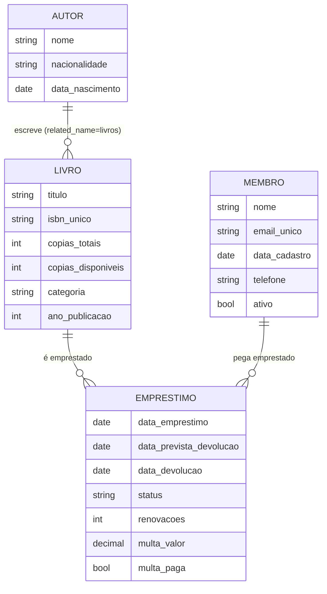

# 📚 Projeto 2 — Sistema de Biblioteca com Django

Projeto da disciplina **Construção de Backend** (IESB). Evolui o Projeto 1 (um único Model em CRUD) para um sistema com **quatro Models relacionados**, onde as regras de negócio (quem pode emprestar o quê, quando um livro está atrasado, quanto custa o atraso) vivem no código Python, e não apenas no banco.

> **Status:** projeto completo, 18 testes automatizados passando, repositório Git local com commit inicial e configuração de publicação testada com gunicorn. A publicação em si (GitHub / hospedagem) depende da sua conta; o passo a passo está na seção [Publicação](#-publicação).

---

## 📑 Sumário
1. [Funcionalidades](#-funcionalidades)
2. [Tecnologias e estrutura](#-tecnologias-e-estrutura)
3. [Como rodar](#-como-rodar-no-windows)
4. [Modelagem de dados](#-modelagem-de-dados)
5. [Passo a passo da construção](#-passo-a-passo-da-construção)
6. [Regras de negócio](#-regras-de-negócio)
7. [Desafios extras](#-desafios-extras-o-que-foi-acrescentado)
8. [Dificuldades encontradas](#-dificuldades-encontradas)
9. [Fluxo de funcionamento (com prints)](#-fluxo-de-funcionamento-com-prints)
10. [Checklist de entrega](#-checklist-de-entrega)
11. [Publicação](#-publicação)
12. [Limitações e próximos passos](#-limitações-e-próximos-passos)

---

## ✅ Funcionalidades

**Requisitos do enunciado**
1. Cadastro de Autores, Livros e Membros pelo Django Admin.
2. Livro sem cópias disponíveis **não pode** ser emprestado.
3. Ao emprestar: prazo automático de **14 dias** e `copias_disponiveis -= 1`.
4. Ao devolver: registra a data, atualiza o status e `copias_disponiveis += 1`.
5. Lista de empréstimos de um Membro, com **indicação visual de atraso**.
6. Relatório dos **livros mais emprestados** (maior → menor).

**Extras que criei** (detalhes [mais abaixo](#-desafios-extras-o-que-foi-acrescentado)): painel com indicadores, busca e filtro por categoria com paginação, renovação de empréstimo, multa por atraso com pagamento, limite de empréstimos por membro, bloqueio de membro inativo/com multa, páginas de autores e membros, relatórios adicionais, comandos de gerenciamento e ações em lote no Admin.

---

## 🧰 Tecnologias e estrutura

Python 3.12 · Django 6 · SQLite · WhiteNoise + gunicorn (produção) · HTML/CSS puro, sem framework de front-end.

```
Projeto 2/
├── manage.py
├── requirements.txt · Procfile · .gitignore
├── config/                      # settings (via variáveis de ambiente), urls, wsgi
├── biblioteca/
│   ├── models.py                # Autor, Livro, Membro, Emprestimo
│   ├── services.py              # REGRAS DE NEGÓCIO (emprestar, devolver, renovar, pagar_multa…)
│   ├── views.py                 # finas: recebem a requisição, chamam services, mostram mensagens
│   ├── urls.py · admin.py · tests.py
│   ├── migrations/              # 0001 (núcleo) e 0002 (extras)
│   ├── management/commands/     # popular_dados · atualizar_atrasados
│   ├── static/biblioteca/style.css
│   └── templates/biblioteca/    # base, painel, livros, autores, membros, relatório…
└── docs/                        # prints e script que os gera
```

---

## 🚀 Como rodar (no Windows)

```bat
cd "C:\Users\caios\OneDrive\Documentos\Faculdade\Projeto 2"
python -m venv venv
venv\Scripts\activate
pip install -r requirements.txt
python manage.py migrate
python manage.py createsuperuser
python manage.py popular_dados      :: opcional: dados de demonstração
python manage.py runserver
```

| Endereço | O que é |
|---|---|
| `http://127.0.0.1:8000/` | Painel |
| `/livros/` · `/autores/` · `/membros/` | Telas de consulta e empréstimo |
| `/membro/<id>/emprestimos/` | Empréstimos de um membro |
| `/relatorio/` | Relatórios |
| `/admin/` | Cadastros (Django Admin) |

Testes: `python manage.py test` (18 testes). Sincronizar atrasos: `python manage.py atualizar_atrasados`.

---

## 🗂️ Modelagem de dados



`esta_atrasado`, `dias_atraso`, `multa_atual` e `pode_renovar` são **`@property`**: dados calculados, sem coluna no banco.

---

## 🛠️ Passo a passo da construção

Seguindo a divisão em sessões sugerida no enunciado.

**Sessão 1 — Modelagem e migrations**
1. `django-admin startproject config .` e `python manage.py startapp biblioteca`.
2. Registrei `'biblioteca'` em `INSTALLED_APPS` e configurei `pt-br` e `America/Sao_Paulo`.
3. Criei os 4 Models com `ForeignKey` (Livro→Autor com `related_name='livros'`; Emprestimo→Livro; Emprestimo→Membro).
4. `makemigrations` + `migrate` → `0001_initial`.

**Sessão 2 — Django Admin**
5. `list_display`, `search_fields` e `list_filter` para os quatro Models.
6. `EmprestimoInline` (`TabularInline`) dentro de `MembroAdmin`: os empréstimos do membro são geridos na mesma tela.

**Sessão 3 — Regras de negócio**
7. Em vez de colocar tudo nas Views, criei `services.py` com funções `emprestar`, `devolver`, `renovar`, `pagar_multa`. Cada uma roda dentro de `transaction.atomic()` e levanta `RegraNegocioError` quando uma regra é violada.
8. As Views só chamam o service e transformam o resultado em mensagem (`messages.success` / `messages.error`). Isso deixa as regras testáveis sem passar pelo navegador.
9. `annotate(total_emprestimos=Count('emprestimo'))` para o relatório.

**Sessão 4 — Templates e checklist**
10. `base.html` com menu e área de mensagens; telas de painel, livros (busca/filtro/paginação), autores, membros, empréstimos do membro e relatórios.
11. Badges coloridos: verde = devolvido, laranja = em andamento, vermelho = atrasado.

**Sessão 5 — Extras, testes e entrega**
12. Campos novos geraram a migration `0002` (ver [dificuldades](#-dificuldades-encontradas)).
13. 18 testes automatizados cobrindo cada requisito e cada regra extra.
14. Prints gerados com Playwright sobre o app rodando (`docs/gerar_prints.py`).
15. Configuração para publicação (variáveis de ambiente, WhiteNoise, gunicorn, Procfile).

---

## 📏 Regras de negócio

Todas parametrizadas como constantes em `Emprestimo` (`models.py`).

| Regra | Valor | Onde |
|---|---|---|
| Sem cópias disponíveis → bloqueia | — | `services.emprestar` |
| Prazo de devolução | 14 dias | `PRAZO_DIAS` |
| Limite de empréstimos em aberto por membro | 3 | `LIMITE_ATIVOS` |
| Mesmo livro duas vezes para o mesmo membro | bloqueia | `services.emprestar` |
| Membro inativo | bloqueia | `services.emprestar` |
| Membro com multa pendente | bloqueia até pagar | `services.emprestar` |
| Renovação | +7 dias, no máximo 2 vezes, só se não estiver atrasado | `services.renovar` |
| Multa por atraso | R$ 1,00 por dia, cobrada na devolução | `MULTA_POR_DIA` |
| Devolver duas vezes o mesmo empréstimo | bloqueia | `services.devolver` |

---

## ⭐ Desafios extras: o que foi acrescentado

O enunciado trata os desafios como opcionais, mas sem eles o sistema ficaria incompleto. O texto dos desafios não fazia parte do material que recebi, então os extras abaixo foram escolhidos por mim.

| Extra | Por que faz sentido |
|---|---|
| **Categoria e ano** no Livro | Permite buscar e filtrar o acervo |
| **Telefone e `ativo`** no Membro | Contato e possibilidade de suspender cadastro |
| **Renovação** (+7 dias, até 2×) | Fluxo real de biblioteca |
| **Multa por atraso** + **pagar multa** + bloqueio | Dá consequência ao atraso |
| **Limite de 3 empréstimos** e bloqueio de duplicidade | Evita acumular o acervo |
| **Painel** com indicadores | Visão geral rápida |
| **Busca, filtro e paginação** de livros | Usabilidade |
| **Páginas de Autores/Membros** | Demonstra `autor.livros.all()` (related_name) |
| **Relatórios**: livros mais emprestados, membros mais ativos, atrasados | Vai além do relatório mínimo |
| Comando **`atualizar_atrasados`** | Pode ser agendado para manter o `status` sincronizado |
| Comando **`popular_dados`** | Demonstração e testes manuais |
| **Ações em lote** no Admin | Devolver vários empréstimos de uma vez |

---

## 🧗 Dificuldades encontradas

Registro honesto dos problemas reais que apareceram e como foram resolvidos.

1. **O passo a passo redireciona para `lista_livros`, mas a rota não existia.** Seguir o anexo ao pé da letra gera `NoReverseMatch`. Criei a view `lista_livros`, a URL e o template.
2. **`request.POST` em view acessível por GET.** O anexo lê `membro_id` de `request.POST`, mas nada impedia abrir a URL pelo navegador (GET), e `emprestar_livro` precisa de formulário com ``. Usei `@require_POST` (GET retorna 405, há teste para isso).
3. **Devolução dupla inflava o estoque.** Devolver duas vezes o mesmo empréstimo somava `+1` cópia duas vezes. Agora o service recusa se o status já é `DEVOLVIDO` (há teste).
4. **`esta_atrasado` só funcionava para status `ATIVO`.** Ao criar o comando que grava `ATRASADO`, a property passaria a retornar `False` para esses registros. Mudei a condição para `status != 'DEVOLVIDO'`; assim a property é a fonte da verdade na tela e o `status` gravado é apenas sincronizado.
5. **Regra nova quebrou meus próprios dados de demonstração.** O `popular_dados` falhou com `RegraNegocioError`: uma devolução antiga com atraso gerou multa e bloqueou o próximo empréstimo da mesma pessoa. Foi uma boa confirmação de que o bloqueio funciona; ajustei as datas do seed.
6. **Formato de moeda inconsistente.** O mesmo valor aparecia como `R$ 11`, `R$ 11,00` e `R$ 11.00`. Criei o helper `brl()` para mensagens e usei `floatformat:2` nos templates.
7. **`select_for_update()` não trava no SQLite.** Ele protege contra duas pessoas emprestando a última cópia ao mesmo tempo em PostgreSQL/MySQL, mas o SQLite ignora o bloqueio de linha (não dá erro, só não protege). Mantive porque a regra fica correta ao trocar de banco, mas vale saber disso.
8. **Datas e fuso.** `date.today()` usa o relógio do servidor; troquei por `timezone.localdate()`, que respeita `TIME_ZONE`.
9. **Migrations já entregues.** Como a `0001_initial` já havia sido entregue na primeira versão, não a reescrevi: os campos extras entraram como `0002`, o que preserva o histórico e não quebra bancos já criados.
10. **Aviso do WhiteNoise em desenvolvimento** (pasta `staticfiles` inexistente). Passei a ativá-lo somente quando `DEBUG=0`.
11. **Gerar os prints.** O servidor de desenvolvimento precisa estar no ar durante a captura, e os dados têm que estar num estado previsível. O script `docs/gerar_prints.py` percorre o fluxo real (clicando nos botões), na ordem certa.

---

## 🔄 Fluxo de funcionamento (com prints)

### 1. Painel
Ponto de partida: títulos, cópias disponíveis, membros, empréstimos em aberto, atrasados e multas pendentes, mais os últimos empréstimos.


### 2. Acervo: busca, filtro e disponibilidade
`/livros/` lista o acervo com paginação. O badge mostra `disponíveis/totais` (vermelho quando zera). A busca aceita título, autor ou ISBN, e o filtro, a categoria.


### 3. Emprestar (requisitos 2 e 3)
Escolhe-se o membro e clica em **Emprestar**. A view chama `services.emprestar`, que valida as regras, cria o `Emprestimo` com devolução em 14 dias e decrementa a cópia.


### 4. Regras bloqueando o empréstimo
Sem cópia disponível (requisito 2) e membro com multa pendente: o service levanta `RegraNegocioError` e a view mostra a mensagem, sem criar nada.


### 5. Empréstimos do membro (requisito 5)
Lista com situação por badge: **vermelho** = atrasado (com dias de atraso), **laranja** = em andamento, **verde** = devolvido. Mostra renovações usadas, multa e ações.


### 6. Renovar
Soma 7 dias ao prazo; contador `1/2`. Livros atrasados não podem ser renovados.


### 7. Devolver e multa (requisito 4)
Registra a data, muda o status para `DEVOLVIDO`, devolve a cópia ao estoque e, se houve atraso, calcula a multa (R$ 1,00 × dias).


### 8. Pagar multa
Libera o membro para novos empréstimos.


### 9. Relatórios (requisito 6)
`annotate(Count('emprestimo'))` ordena os livros do mais para o menos emprestado; há também os membros mais ativos e os atrasados com a multa acumulada.


### 10. Autor e `related_name`
A lista de obras vem de `autor.livros.all()`, sem query manual.


### 11. Django Admin
Cadastro de Autores, Livros e Membros (requisito 1). O `TabularInline` mostra os empréstimos do membro na mesma tela, e há ações em lote em Empréstimos.


---

## ☑️ Checklist de entrega

**Checklist oficial do enunciado** (cada item foi verificado em um ambiente virtual limpo)

- [x] Os 4 Models (`Autor`, `Livro`, `Membro`, `Emprestimo`) criados e migrados sem erros (`makemigrations --check` → *No changes detected*)
- [x] Admin com `AutorAdmin`, `LivroAdmin` (`autor` e `copias_disponiveis` no `list_display`) e `MembroAdmin` com `EmprestimoInline`
- [x] A View de empréstimo bloqueia quando `copias_disponiveis` é zero, sem quebrar a aplicação (teste `test_req2_nao_empresta_sem_copias` e print 05)
- [x] A View de devolução incrementa `copias_disponiveis` e atualiza o `status` (teste `test_req4_devolver_atualiza_status_e_estoque`)
- [x] O template "meus empréstimos" exibe o badge de atraso usando a property `esta_atrasado`
- [x] "Livros mais emprestados" com `annotate()` + `Count()` funciona no shell (`python manage.py shell`, ver abaixo)
- [x] Banco populado com ao menos 3 Autores, 5 Livros e 3 Membros: `python manage.py popular_dados` cria **5 autores, 8 livros e 3 membros**

Consulta usada no shell:
```python
from django.db.models import Count
from biblioteca.models import Livro
for l in Livro.objects.annotate(total_emprestimos=Count('emprestimo')).order_by('-total_emprestimos'):
    print(l.titulo, l.total_emprestimos)
```

**Publicação no GitHub**

- [x] `README.md` com explicação do projeto e prints (Admin, listagem de livros, empréstimos): seção [Fluxo de funcionamento](#-fluxo-de-funcionamento-com-prints)
- [x] `requirements.txt` com versões fixadas (gerado com `pip freeze` em ambiente limpo)
- [x] `.gitignore` cobrindo `venv/` e `db.sqlite3` (verificado com `git check-ignore`)
- [ ] Repositório público criado e enviado (`git push`): precisa ser feito na sua conta, ver [Publicação](#-publicação)

**Objetivos de aprendizagem**

- [x] `ForeignKey` entre múltiplos Models · [x] `related_name` (`autor.livros.all()`) · [x] regras de negócio no backend · [x] `@property` (`esta_atrasado`) · [x] `annotate()` + `Count()` · [x] Admin com `list_display` e `TabularInline`

**Requisitos funcionais 1 a 6**: todos atendidos (ver [Funcionalidades](#-funcionalidades)).

**Qualidade extra**: 18 testes automatizados passando e configuração de produção testada com gunicorn.

> **Sobre a estrutura de pastas:** segui a estrutura sugerida (`config/` e `biblioteca/` com `migrations/`, `templates/biblioteca/`, `models.py`, `admin.py`, `views.py`, `urls.py`). A pasta raiz se chama `Projeto 2`, como você pediu, em vez de `biblioteca_projeto`. Além do sugerido, há `services.py`, `tests.py`, comandos de gerenciamento, CSS e a pasta `docs/`.

---

## 🌐 Publicação

O projeto lê `SECRET_KEY`, `DEBUG`, `ALLOWED_HOSTS` e `CSRF_TRUSTED_ORIGINS` de variáveis de ambiente, usa WhiteNoise para os estáticos e traz `Procfile` (`gunicorn config.wsgi`).

**1. GitHub** (crie o repositório como **público**, sem README inicial, pois o projeto já tem um)
```bash
cd "Projeto 2"
git remote add origin https://github.com/SEU_USUARIO/projeto-2-biblioteca.git
git branch -M main
git push -u origin main
```

**2. Hospedagem (ex.: PythonAnywhere ou Render)** — comandos de build/instalação:
```bash
pip install -r requirements.txt
python manage.py migrate
python manage.py collectstatic --noinput
python manage.py createsuperuser
```
Variáveis: `DEBUG=0`, `SECRET_KEY=<valor longo e aleatório>`, `ALLOWED_HOSTS=seu-dominio`, `CSRF_TRUSTED_ORIGINS=https://seu-dominio`.
No Render, o comando de start é `gunicorn config.wsgi`.

> ⚠️ O SQLite funciona para demonstração, mas muitas hospedagens gratuitas apagam o disco a cada deploy. Para uso real, use PostgreSQL.

---

## 🔭 Limitações e próximos passos
- As telas do front não exigem login (apenas o `/admin/`). Para uso real, adicionar autenticação e permissões.
- Agendar `atualizar_atrasados` (Agendador de Tarefas do Windows ou cron) para manter o `status` sincronizado.
- Reservas de livros esgotados, capas de livros e envio de e-mail de aviso de vencimento.
- Trocar SQLite por PostgreSQL em produção.

- Teste dePull Request
